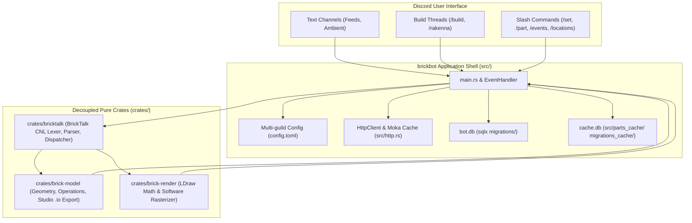

# AGENTS.md — Brickbot (Suomen Palikkaharrastajat Discord Bot)

This document contains detailed information intended for coding agents, LLMs, and developers working on the `brickbot` codebase. For human-facing installation and deployment instructions, refer to [`README.md`](README.md).

---

## 1. Project Overview & Ecosystem Role

`brickbot` is a statically-linked Rust-based Discord bot powering the official community server of **Suomen Palikkaharrastajat ry** (the Finnish LEGO® Enthusiasts Association).

It operates alongside its sister project [`planet`](../planet):
- While `planet` aggregates community blogs, Flickr photostreams, and news into a public static web portal at [palikkaharrastajat.fi](https://palikkaharrastajat.fi),
- `brickbot` runs 24/7 on the association's Discord server to provide real-time feed syndication, calendar event synchronization, Rebrickable part/set lookups, and collaborative building sessions in Discord threads via the **BrickTalk** domain-specific language.



---

## 2. Technology Stack

- **Rust**: Core programming language (Edition 2021).
- **Serenity (`0.12`)**: Discord API wrapper (using `rustls_backend`).
- **Tokio (`1`)**: Asynchronous runtime for concurrent background tasks and polling loops.
- **Reqwest (`0.12`)**: HTTP client for fetching RSS/Atom feeds, iCal data, and LEGO APIs.
- **Moka (`0.12`)**: Fast, concurrent in-memory caching.
- **RSS (`2.0`) & OPML (`1.1`)**: Feed parsing libraries.
- **SQLx (`0.8`)**: Async SQLite database interaction using `runtime-tokio-rustls`.
- **rust-i18n (`3`)**: Lightweight macro-based localization system for `en-US` and `fi-FI`.
- **urlencoding (`2.1`)**: Robust percent-encoding for PocketBase API filter parameters.
- **Nix & Devenv**: Declarative developer environment (`devenv.nix`) and static MUSL binary compilation.

---

## 3. Development Methodology & Workflows

### 1. Pure Decoupling for Testability
To keep this project maintainable by AI coding agents, core business logic (formatting, algorithms, decision making) **MUST** be strictly decoupled from external API surfaces (like `serenity` Discord integrations, SQLx, or `reqwest`):
- Extract message building, geometry calculations, and parsing into pure, unit-tested functions.
- Target comprehensive test coverage over these pure components.
- Utilize traits or dependency injection to mock database interfaces and HTTP clients when testing outer orchestrating layers.

### 2. Red / Green TDD Cycle
All new feature development or bug fixes must follow the Test-Driven Development (TDD) cycle:
1. Write a failing unit or integration test (Red).
2. Implement the minimum code required to make it pass (Green).
3. Refactor while keeping all tests passing.

### 3. Makefile Commands & Targets

> [!WARNING]
> **Makefile Targets Trap for Agents**:
> - `make test` has **NO recipe** in `brickbot/Makefile` and exits immediately with success without running tests! Always use **`make test-fast`** or **`cargo test`**.
> - `make coverage` has **NO recipe** in `brickbot/Makefile`! Always use **`make coverage-lcov`** or **`make coverage-html`**.
> - `trainer-review` and `trainer-export` are legacy targets referencing an obsolete binary that no longer exists in `Cargo.toml`.

| Command | Action | Notes |
| :--- | :--- | :--- |
| `make test-fast` | Runs all Rust workspace tests (`cargo test`) | Fast test execution across all workspace crates. |
| `make check` | Runs non-mutating checks: formatting check, Clippy with `-D warnings`, and `test-fast` | Used as the Git pre-commit hook in `devenv`. |
| `make format` | Mutating code formatter (`cargo clippy --fix` + `treefmt`) | Runs before committing code changes. |
| `make format-check` | Non-mutating formatting check (`treefmt --fail-on-change`) | Verifies formatting. |
| `make lint` | Runs Clippy with warnings denied (`cargo clippy -- -D warnings`) | Lints whole workspace. |
| `make coverage-html` | Generates HTML coverage reports | Uses `cargo-llvm-cov --all-features --workspace --html`. |
| `make coverage-lcov` | Generates `lcov.info` file | Uses `cargo-llvm-cov`. |
| `make run` | Runs `brickbot` locally | Automatically ensures `mkdir -p data`. |
| `make watch` | Watches for changes and runs bot locally | Passes `--build-debug-log data/build-debug.log`. |
| `make fetch-ldraw` | Downloads LDraw part library into configured data directory | Necessary for full 3D parts rendering. |
| `make build` | Builds static MUSL binary with Nix | `nix build` producing `result/bin/brickbot`. |

Run commands within `devenv`:
```bash
cd /workspace/brick-planet/brickbot
devenv shell -- make test-fast
devenv shell -- make check
```

---

## 4. Architecture & Repository Structure

### Cargo Workspace Layout

```text
brickbot/
├── Cargo.toml               # Workspace manifest (members: ["crates/*"], default-members: [".", "crates/*"])
├── build.rs                 # Build script for git metadata
├── config.toml              # Active bot configuration
├── config.toml.example      # Documented example configuration
├── default.nix              # Decoupled Nix build expression (avoids dirty-tree rebuilds)
├── devenv.nix               # Declarative development environment (Rust MUSL toolchain, treefmt, git-hooks)
├── flake.nix                # Flake entry point
├── locales/                 # Shared localization bundles
│   ├── en-US.yml            # English translations
│   └── fi-FI.yml            # Finnish translations
├── migrations/              # SQLite migrations for bot.db (bot state, feeds, events, build sessions)
├── migrations_cache/        # SQLite migrations for cache.db (disposable Rebrickable parts cache)
├── data/                    # Local SQLite databases and LDraw library (gitignored)
│   ├── bot.db               # Primary persistent database
│   └── cache.db             # Disposable parts cache database
├── src/                     # Main brickbot executable crate
│   ├── main.rs              # Application entry point, Discord event loop, Autocomplete handler
│   ├── config.rs            # Multi-guild TOML configuration structures (#[serde(deny_unknown_fields)])
│   ├── config_report.rs     # CLI --explain-config implementation
│   ├── http.rs              # Centralized HttpClient wrapper with Moka caching & structured tracing
│   ├── i18n.rs              # Localization tests validating bundle parity and placeholders
│   ├── reload.rs            # SIGHUP configuration reload and in-place re-exec
│   ├── rss.rs               # RSS/Atom polling loops, scheduling, and digest batching
│   ├── pocketbase.rs        # PocketBase CRUD operations (events, locations) and push_record_data
│   ├── pocketbase/          # PocketBase syndication and catalog integration
│   │   └── feeds.rs         # Remote feed fetching, upsert_feed_item with URL-encoded filter, moderation barrier
│   ├── commands/            # Slash command modules (set.rs, part.rs, events.rs, locations.rs, build.rs)
│   ├── workflows/           # Multi-step interactive wizards (events/, locations/, search.rs, ambient.rs)
│   ├── parts_cache/         # Disposable parts database interface (warm.rs, db.rs)
│   └── build/               # Discord interactive shell for /build (session/, scene.rs, debug_log.rs)
├── crates/
│   ├── brick-model/         # Pure LEGO model domain (units, model, ops append log, Studio .io export)
│   ├── brick-render/        # Pure software 3D rasterizer & LDraw parser (math, ldraw, render)
│   └── bricktalk/           # BrickTalk controlled natural language interpreter (dsl, lower, expand, dispatch)
└── docs/                    # Architectural documents, ADRs, command and interaction guides
```

### Two Distinct SQLite Databases
1. **`data/bot.db`**:
   - Manages persistent bot state: feed sightings, digest queues, calendar events, Zulip moderation mappings, and collaborative build session revision histories (`build_sessions`, `build_revisions`).
   - Migrated using `migrations/`.
2. **`data/cache.db`**:
   - Manages derived, disposable Rebrickable part/color lookups (`src/parts_cache/`).
   - Migrated using `migrations_cache/`.
   - Tiered expiry: part details never expire, searches expire in 30 days, empty results expire in 1 hour.
   - Separate connection pool and separate migrations to prevent schema cross-contamination.

### PocketBase Feed Syndication & Moderation Architecture

When configured with `[pocketbase]`, `brickbot` integrates directly with the association's central PocketBase backend (`src/pocketbase/`):

1. **Feed Catalog Ingestion (`fetch_active_feeds`)**:
   - Queries PocketBase's `feeds` collection: `/api/collections/feeds/records?filter=(enabled=true)&perPage=500`.
   - Dynamically pulls active feed URLs, titles, exclude keywords, and exclude URL rules, augmenting local `config.toml` sources without requiring a bot restart.
2. **Feed Item Upserting (`upsert_feed_item`)**:
   - When new posts are fetched during feed polling, `upsert_feed_item` checks whether the post exists using the filter:
     `(feed='<encoded_feed_id>'%26%26guid='<encoded_guid>')`
   - Both `feed_id` and `item.id` (`guid`) are URL-encoded using `urlencoding::encode` to safely handle special characters (e.g. `'`, `&`, `?`, `#`) without breaking PocketBase filter syntax or query delimiters.
   - If missing, creates a new record in `feed_items` with metadata (`feed`, `guid`, `link`, `title`, `description`, `snippet`, `published_at`, `thumbnail`, `media_type`, `is_hidden: false`).
   - If present and visible, patches updated metadata (`title`, `description`, `thumbnail`).
3. **`is_hidden` Moderation Barrier**:
   - If an existing record in `feed_items` has `is_hidden = true` (flagged or suppressed by community moderators):
     - `upsert_feed_item` immediately returns `is_hidden: true` and **refuses to overwrite** or unhide the item.
     - The RSS polling loop in `src/rss.rs` detects `is_hidden` and suppresses posting the article to Discord channels.
     - All public item queries explicitly filter with `filter=(is_hidden=false)`, guaranteeing suppressed posts never leak.
4. **LEGO Set Community Lookup (`/set`)**:
   - In `src/commands/set.rs`, looking up a set queries PocketBase via `search_feed_items`:
     `/api/collections/feed_items/records?filter=(is_hidden=false)&perPage=100&expand=feed`
   - Discovered articles are matched against the set number, name, and theme and displayed alongside official LEGO metadata.
   - If PocketBase is unavailable or unconfigured, the bot automatically falls back to local SQLite article search (`db::search_feed_items`).

---

## 5. The `/build` Command & BrickTalk CNL

The `/build` (or `/rakenna` in Finnish) command enables collaborative LEGO building inside a Discord thread. It is driven by a hand-crafted recursive-descent parser for a **controlled natural language (CNL)** — deliberately eliminating external LLMs for zero latency, 100% reproducibility, and privacy.

### The Pure Pipeline
```
Discord Message
      │
      ▼
crates/bricktalk/src/dsl/block.rs (Lifts fenced ASCII drawings before parsing)
      │
      ▼
crates/bricktalk/src/dsl/{lexer,parser,ast}.rs (Tokenize + parse grammar + silence policy)
      │
      ▼
crates/bricktalk/src/lower.rs (Resolves references/landmarks against model state, emits Ops)
      │
      ▼
crates/bricktalk/src/expand.rs & grid.rs (Expands structures/drawings into individual placements)
      │
      ▼
crates/bricktalk/src/legal.rs (Legal geometry correction: whole studs, whole plates, collisions)
      │
      ▼
crates/brick-model/src/ops.rs (Append-only History/Op log, apply)
      │
      ▼
crates/bricktalk/src/dispatch.rs::process_message (Single pure entry point returning Outcome)
      │
      ▼
src/build/session/ (Discord shell: thread creation, debounced renders, modals, buttons)
```

### Key Architectural Constraints
1. **Silence Policy**:
   - A message in a build thread is treated as a command only if its first word is a known verb or question word.
   - Ordinary member chat is silently ignored with no reply, reaction, or render.
   - A known-verb sentence that fails to parse emits a helpful localized diagnostic.
   - Blockquote lines (`> ...`, `>>> ...`) are stripped before parsing to prevent quoting bot messages from re-triggering commands.
2. **Legal Geometry Guarantee**:
   - Operations are corrected before dispatch (`crates/bricktalk/src/legal.rs`).
   - Placements snap to whole studs horizontally (20 LDU) and whole plates vertically (8 LDU).
   - The corrected operation is what enters the revision log; replaying history is legal by construction.
3. **Software Rendering & Studio Export**:
   - Bursts of commands debounce into a single render (`render_debounce_ms`) via `crates/brick-render`.
   - Renders 3D isometric PNGs using software rasterization.
   - Falls back to bounding boxes if the LDraw library is missing (`make fetch-ldraw`).
   - `[Export .io]` or `Export.` produces a BrickLink Studio `.io` file (Zip archive containing part references and thumbnail) via `crates/brick-model/src/export/`.

---

## 6. Localization (i18n) & Multi-Guild Configuration

### Localization Parity
- User-facing text must use `rust_i18n::t!`.
- Both `locales/en-US.yml` and `locales/fi-FI.yml` must be updated together.
- `src/i18n.rs` contains unit tests that parse both YAML bundles and fail if:
  - Any translation key exists in one locale but not the other.
  - Any placeholder (`%{name}`) differs between the translations.
  - Any translation value is blank.
- Modal titles and text input labels are capped at 45 characters by Discord API constraints.
- Note on `src/i18n.rs`: The test resolves bundle paths via `env!("CARGO_MANIFEST_DIR")`. If the repository directory changes, re-running `cargo test` recompiles the binary with the updated manifest directory.

### Configuration (`config.toml`)
- Every configuration struct uses `#[serde(deny_unknown_fields)]` to prevent silently ignoring misplaced TOML keys.
- Feature settings live in root tables (`[feeds]`, `[ambient]`, `[resource_limits]`, `[commands.*]`) and can be overridden per guild in `[[guilds]]` blocks (e.g. `guilds.commands.events.enabled`).
- CLI flags:
  - `--check-config`: Validates syntax and configuration constraints.
  - `--explain-config`: Dumps effective resolved configuration tables for each guild.

---

## 7. Crucial Gotchas & Change Rules for Agents

1. **Makefile Target Names**:
   - Never run `make test`. Run `make test-fast` or `cargo test`.
   - Never run `make coverage`. Run `make coverage-lcov` or `make coverage-html`.
2. **Nix File Tracking**:
   - Any new `.rs` file added to `src/` or `crates/` **must be tracked in Git** (`git add <file>`). Otherwise, the Nix builder ignores it and compilation fails with `file not found for module`.
3. **SQLite Directory Initialization**:
   - SQLite cannot create parent directories. Ensure `mkdir -p data` has run before starting the bot or executing test runners requiring local databases.
4. **No External LLM Calls**:
   - Retain the strict No-LLM stance in `brickbot`. Do not introduce runtime network calls to external AI models for conversational parsing or ambient detection.
5. **Always Verify with Checks**:
   - Before completing work, run `devenv shell -- make check`.
